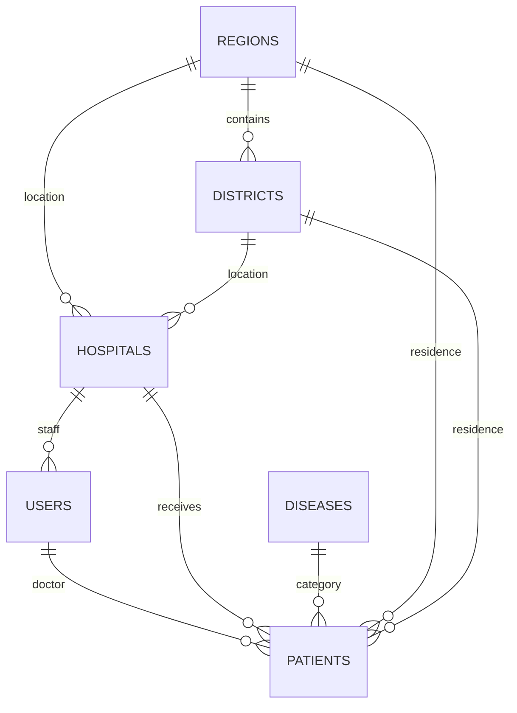

# Topshiriq bajarilishi

Manba: `Internship test2 project.docx` hujjatidagi shifoxonada fuqarolarni ro‘yxatga olish vazifasi.

| Talab | Amalga oshirilgan joy |
| --- | --- |
| Laravel va Vue | Laravel 12, Vue 3, Vue Router, Vite |
| Rahbar va shifokor rollari | `role` middleware, bemor policy, serverda ma’lumot doirasini cheklash |
| Admin barcha ma’lumotlarni ko‘radi | Alohida admin roli va barcha shifoxonalar statistikasi |
| Rahbar o‘z shifoxonasiga shifokor qo‘shadi | Shifokorlar bo‘limi, serverda shifoxona avtomatik biriktiriladi |
| Rahbar o‘z shifoxonasi qabulini ko‘radi | Bemorlar ro‘yxati, kartasi, statistika |
| Shifokor fuqaroni qabulga yozadi | Yangi bemor formasi |
| Shifokor o‘z fuqarolari uchun list/show/update/delete | Bemorlar ro‘yxati, kartasi, tahrirlash, tasdiqli o‘chirish |
| Viloyat, tuman, kasallik va shifoxona Seeder orqali | `backend/database/seeders/DatabaseSeeder.php` va mahalliy JSON fayllar |
| Ism, familiya, otasining ismi | Majburiy forma maydonlari |
| Pasport 2 harf + 7 raqam | Brauzer va server validatsiyasi, bosh harfga o‘girish |
| PIN 14 raqam | Brauzer va server validatsiyasi, matn ustuni |
| Viloyat va tuman tanlash | Bog‘langan select; serverda viloyatga tegishlilik tekshiruvi |
| Manzil | Majburiy matn maydoni |
| Kasallik turi | Seeder’dagi ro‘yxatdan tanlash |
| Shifoxona nomi, viloyat, tuman, TIN | Shifoxonalar bo‘limi va validatsiya |
| Shifoxona direktor ma’lumotlari | Rahbarlar bilan bog‘lanish, kartada ism/email/telefon |
| Fuqaro ro‘yxatda ko‘rinishi | Saqlashdan keyin karta, ro‘yxat va statistika orqali ko‘rish |
| Fuqaro ustiga bosganda barcha ma’lumotlar | Ism yoki ko‘rish tugmasi orqali to‘liq karta |
| Har rol uchun 2 tadan user | 2 admin, 2 rahbar, 2 shifokor; jami 6 hisob |
| Tahrirlash va o‘chirish | Bemor, shifokor, rahbar, shifoxona CRUD; rolga muvofiq |

## Talqin qilingan joylar

Hujjatda «2 ta rol» deyilgan, lekin adminning barcha ma’lumotlarni ko‘rish vakolati ham keltirilgan. Shu sabab ikkita asosiy rolga qo‘shimcha admin roli kiritildi.

Rahbarning bemorlar ustidagi vakolati hujjatdagi «qabulini ko‘ra oladi» iborasiga mos ravishda o‘qish bilan cheklangan. Bemorni shifokori va admin tahrirlaydi/o‘chiradi. Rahbar o‘z shifoxonasining ma’lumotlarini tahrirlay oladi; yangi shifoxona yaratish va o‘chirish admin vakolati.

Bitta bemor kartasi bitta shifokorga tegishli qabul yozuvi hisoblanadi. Bir shifokorda pasport yoki PIN qayta takrorlanmaydi; shu fuqaro boshqa shifokorga alohida ro‘yxatdan o‘tishi mumkin. Takroriy qabul uchun mavjud kartaning qabul sanasi/holati yangilanadi. Alohida ko‘p tashrifli tibbiy tarix modeli topshiriq doirasiga kiritilmagan.

TIN/STIR uchun 9 raqamli format qabul qilindi. Qabul sanasi, holati va izohlar ish jarayoni uchun qo‘shimcha maydon sifatida kiritildi.

## Tuzilma

## Tekshirish

PHP feature testlar haqiqiy HTTP controllerlar orqali rollar, ma’lumot doirasi, CRUD, validatsiya, parol hashlash, login chegarasi va seeder takroriy ishlashini tekshiradi. Brauzer testlari oltita hisob, bemor CRUD, rahbarning shifokor CRUD’i, adminning shifoxona va rahbar yaratishi, mobil ko‘rinish va haqiqiy CSRF talabini tekshiradi.

PHP testlari `:memory:` SQLite bazasida ishlaydi. Playwright alohida `backend/database/e2e.sqlite` yaratadi; ishchi `backend/database/database.sqlite`ga tegmaydi.

## Ma’lumot va shrift manbalari

Viloyat/tuman JSON fayllari [MIMAXUZ/uzbekistan-regions-data](https://github.com/MIMAXUZ/uzbekistan-regions-data) ochiq ma’lumotlar to‘plamidan olingan. Bu loyiha ichiga saqlangan snapshot; ma’muriy hududlar yangilanishi avtomatik sinxronlanmaydi. Datasetdagi hudud identifikatorlari o‘z holicha saqlangan. Bemorlar, shifoxonalar va foydalanuvchilar sun’iy test ma’lumotlaridir.

Manrope shrifti [Google Fonts manbasi](https://github.com/google/fonts/tree/main/ofl/manrope) orqali olingan va mahalliy xizmat qiladi. OFL litsenziyasi `frontend/src/assets/fonts/OFL.txt` ichida. Ishlash vaqtida tashqi CDN talab qilinmaydi.

## Frontend va backend ajratilishi

Laravel kodi `backend`, Vue kodi `frontend` ichida. Frontend mustaqil `dist` build yaratadi. API so‘rovlari Vite proxy orqali uzatiladi. CSRF token `/api/csrf` manzilidan olinadi. Shifokor va rahbar controllerlari alohida yozilgan; murakkab query shartlari oddiy `if` bilan ifodalangan. Vue script, template va CSS bloklari o‘qishga qulay formatlangan.
